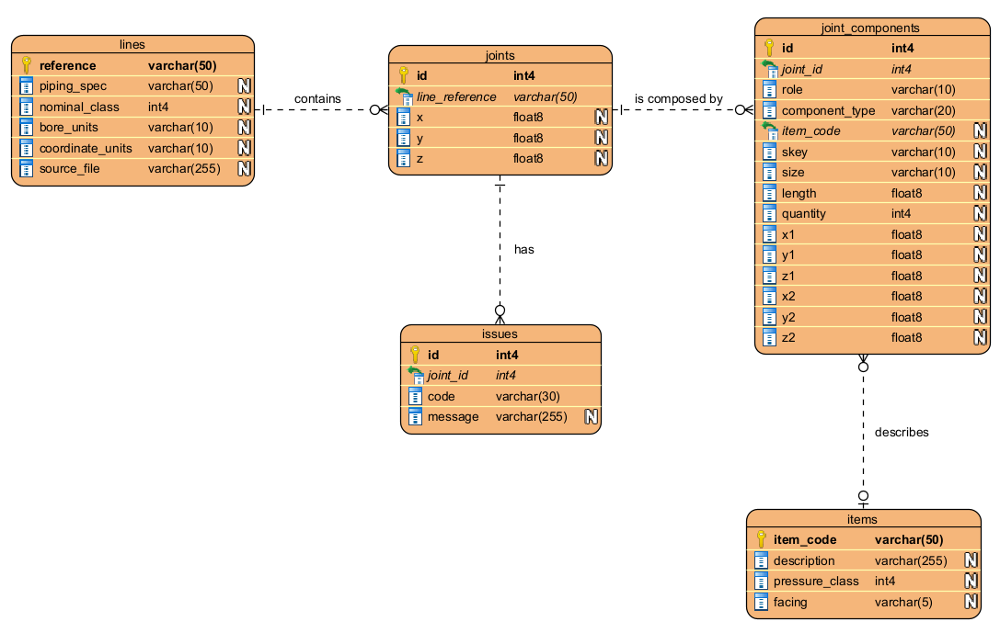

# Piping Flange Parser

A small exploratory prototype: it reads piping data in PCF format, rebuilds
the flanged joints, checks them and stores them in a SQLite database.

In a process plant, pipes are assembled on site through flanged joints: two
flanges, a gasket between them and a set of bolts. A PCF (Piping Component
File) lists these parts one by one, without saying which ones belong together.
This project turns that flat list into a register of joints and reports the
ones that look incomplete or inconsistent.

> Draft project on hand-written sample files. Not meant for production use.

## Example

```text
> python main.py samples/line1.pcf samples/line2_missing_gasket.pcf samples/line3_missing_description.pcf
line1.pcf: 1 joints, 0 issues
line2_missing_gasket.pcf: 1 joints, 1 issues
line3_missing_description.pcf: 1 joints, 1 issues
Database: flanges.db
out/joints.csv: 3 joints
out/issues.csv: 2 issues
```

The issues found, as written to `out/issues.csv`:

| line | joint_id | code | message |
| --- | --- | --- | --- |
| 3"-P-1002 | 2 | MISSING_GASKET | No gasket between the two flanges |
| 3"-P-1003 | 3 | MISSING_DESCRIPTION | Item code FLG-WN-3-150 has no description in MATERIALS |

Requires Python 3.10 or later, no external libraries.

## How it works

| Module | What it does |
| --- | --- |
| `reader.py` | Reads a PCF file into header, components and materials |
| `joints.py` | Groups the components into joints |
| `checks.py` | Reports joints that are incomplete or inconsistent |
| `db.py` | Stores everything in SQLite, using `schema.sql` |
| `main.py` | Runs all the steps and exports two CSV reports |

A joint is rebuilt in three passes:

1. Each gasket is matched with the flanges that touch one of its end points.
2. Flanges left over are paired if they touch each other directly (a joint
   without gasket), otherwise they form a joint on their own.
3. Bolt sets have no coordinates in a PCF, so each one goes to the joint of
   the last flange or gasket that precedes it in the file.

Pressure class and facing are not in the component blocks: they are extracted
from the item description (`FLANGE WN 150# RF ...` gives class 150, facing RF).

## Database



| Table | One row per |
| --- | --- |
| `lines` | Pipeline (one PCF file), with its spec, nominal class and units |
| `items` | Item code: the catalog, with description, pressure class and facing |
| `joints` | Flanged joint, with a reference position |
| `joint_components` | Physical part of a joint: flange A, flange B, gasket or bolt set |
| `issues` | Finding of the checks |

Design notes:

- The joint, not the single flange, is the unit of the model: it is what gets
  assembled and inspected on site.
- Pressure class and facing depend on the item code, so they are stored once
  in `items` instead of on every part.
- All parts of a joint share one table, with their role as data. Separate
  tables per kind of part would give stronger constraints, but a schema change
  for every new kind (spectacle blinds, orifice plates, wafer valves).
- Incomplete data is stored and reported in `issues`, not rejected.

The full column list is in [schema.sql](schema.sql).

## Checks

| Code | Meaning |
| --- | --- |
| `UNPAIRED_FLANGE` | The flange has no mating flange in the file |
| `MISSING_GASKET` | Two flanges are joined with no gasket between them |
| `MISSING_BOLTS` | The joint has no bolt set |
| `MISSING_ITEM_CODE` | A part has no item code |
| `MISSING_DESCRIPTION` | An item code has no description in `MATERIALS` |
| `CLASS_MISMATCH` | The two flanges have different pressure classes |
| `FACING_MISMATCH` | The two flanges have different facings |

## Limitations

- Sample files are written by hand from public descriptions of the PCF
  format; `line2` and `line3` contain anomalies added on purpose.
- Component blocks are recognised from a fixed list of component types.
- Bolt sets are assigned to a joint by their position in the file.
- A flange without a mate is reported as something to verify: it may be
  connected to equipment or to a flanged valve, which are not handled.
- One file is one line; loading the same pipeline reference again replaces it.
- Only the facings `RF`, `FF` and `RTJ` are recognised.

## Possible next steps

- Other input formats and exports from a 3D model.
- Assembly and inspection history linked to each joint.
- Checks at line level and automated tests.
