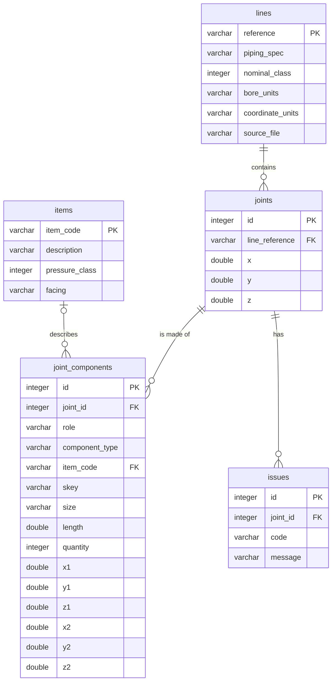

# Piping Flange Parser

A small exploratory prototype that reads piping data in PCF format, rebuilds
the flanged joints, checks them and stores them in a relational database.

In a process plant, piping is assembled on site through flanged joints: two
flanges, a gasket between them and a set of bolts. A PCF (Piping Component
File) lists these parts one by one, without saying which ones belong together.
This project turns that flat list into a register of joints and reports the
joints that look incomplete or inconsistent.

> **Status:** a learning prototype that runs on hand-written sample files.
> It is not meant for production use.

## Example

```text
> python main.py samples/line1.pcf samples/line2_missing_gasket.pcf samples/line3_missing_description.pcf
line1.pcf: 1 joints, 0 issues
line2_missing_gasket.pcf: 1 joints, 1 issues
line3_missing_description.pcf: 1 joints, 1 issues
Database: flanges.db
out/joints.csv: 3 joints
out/issues.csv: 2 issues
```

Part of the joint register written to `out/joints.csv`:

| line | joint_id | x | flange_a_item | flange_b_item | gasket_item | bolt_quantity | issue_count |
| --- | --- | --- | --- | --- | --- | --- | --- |
| 3"-P-1001 | 1 | 1060.0 | FLG-WN-3-150 | FLG-WN-3-150 | GSK-SW-3-150 | 4 | 0 |
| 3"-P-1002 | 2 | 1060.0 | FLG-WN-3-150 | FLG-WN-3-150 | | 4 | 1 |
| 3"-P-1003 | 3 | 1060.0 | FLG-WN-3-150 | FLG-WN-3-150 | GSK-SW-3-150 | 4 | 1 |

And `out/issues.csv`:

| line | joint_id | code | message |
| --- | --- | --- | --- |
| 3"-P-1002 | 2 | MISSING_GASKET | No gasket between the two flanges |
| 3"-P-1003 | 3 | MISSING_DESCRIPTION | Item code FLG-WN-3-150 has no description in MATERIALS |

## How it works

Each module takes the result of the previous one:

| Step | Module | Input → output |
| --- | --- | --- |
| 1 | `reader.py` | PCF text → header, list of components, materials table |
| 2 | `joints.py` | components → joints (parts that share an end point belong together) |
| 3 | `checks.py` | joints → issues |
| 4 | `db.py` | line, joints and issues → SQLite database (`schema.sql`) |
| 5 | `main.py` | runs steps 1–4 on every file and exports two CSV reports |

How a joint is rebuilt:

1. Every gasket is matched with the flanges that touch one of its end points.
2. Flanges left over are paired if they touch each other directly (a joint
   without gasket), otherwise they form a joint on their own.
3. Bolt sets have no coordinates in a PCF, so each one is given to the joint
   of the last flange or gasket that precedes it in the file.

Pressure class and facing are not written in the component blocks: they are
extracted from the item description in the `MATERIALS` section
(for example `FLANGE WN 150# RF ...` → class 150, facing RF).

## Database schema



| Table | One row per | Notes |
| --- | --- | --- |
| `lines` | pipeline (one PCF file) | header data: spec, nominal class, units |
| `items` | item code | the catalog: description, pressure class, facing |
| `joints` | flanged joint | `x, y, z` is a reference point: where flange A meets the gasket |
| `joint_components` | physical part of a joint | `role` is `FLANGE_A`, `FLANGE_B`, `GASKET` or `BOLTS`; `x1..z2` are the two end points of the part |
| `issues` | finding of the checks | a short code and a readable message |

A line contains joints, a joint is made of components, and each component is
one instance of a catalog item.

## Usage

Requirements: Python 3.10 or later. No external libraries.

```text
python main.py samples/line1.pcf samples/line2_missing_gasket.pcf samples/line3_missing_description.pcf
```

Options: `--db` sets the database file (default `flanges.db`), `--out` sets
the folder for the CSV reports (default `out`).

Each module can also be run on its own to see its result:

```text
python reader.py samples/line1.pcf
python joints.py samples/line1.pcf
python checks.py samples/line2_missing_gasket.pcf
```

Example queries on the database:

```sql
-- Class 150 flanges of one line
SELECT j.line_reference, c.joint_id, c.role, c.skey, c.size,
       i.pressure_class, i.facing
FROM joint_components AS c
JOIN joints AS j ON j.id = c.joint_id
JOIN items AS i ON i.item_code = c.item_code
WHERE c.component_type IN ('FLANGE', 'FLANGE-BLIND')
  AND i.pressure_class = 150
  AND j.line_reference = '3"-P-1001';

-- Joints with an issue, and where they are
SELECT j.line_reference, j.id, j.x, j.y, j.z, s.code, s.message
FROM issues AS s
JOIN joints AS j ON j.id = s.joint_id
ORDER BY j.line_reference;
```

## Checks

| Code | Meaning |
| --- | --- |
| `UNPAIRED_FLANGE` | The flange has no mating flange in the file |
| `MISSING_GASKET` | Two flanges are joined with no gasket between them |
| `MISSING_BOLTS` | The joint has no bolt set |
| `MISSING_ITEM_CODE` | A part has no item code |
| `MISSING_DESCRIPTION` | An item code has no description in `MATERIALS` |
| `CLASS_MISMATCH` | The two flanges have different pressure classes |
| `FACING_MISMATCH` | The two flanges have different facings |

Every check is a small function in `checks.py`; adding one means writing a
function and adding it to the `ALL_CHECKS` list.

## Design decisions

- **The joint is the unit, not the single flange.** What is assembled,
  tightened and inspected on site is the joint, so `joints` is the central
  table.
- **A catalog table.** Description, pressure class and facing depend on the
  item code, not on the single part, so they are stored once in `items`.
- **One `joint_components` table with the role as data.** The alternative
  considered was one table per kind of part (`flanges`, `gaskets`,
  `bolt_sets`): stronger constraints, but a schema change for every new kind
  of part. Real joints can hold other parts (spectacle blinds, orifice plates,
  wafer valves) and more than one gasket, so the generic table was preferred.
- **Incomplete data is stored and reported, not rejected.** A part without
  item code, or a joint without gasket, is saved as it is and flagged in
  `issues`.
- **The line's nominal class and the item's pressure class are kept
  separate**, so that a mismatch can be detected.
- **SQLite for zero setup.** `schema.sql` uses standard SQL only.
- **The reader is independent from the joint logic**, so another input format
  could be added without touching the rest.

## Assumptions and limitations

- The sample files were written by hand, following publicly available
  descriptions of the PCF format. `line2` and `line3` contain anomalies added
  on purpose to exercise the checks.
- Component blocks are recognised from a fixed list of component types; an
  unknown type is read as an attribute of the previous block.
- Bolt sets are assigned by their position in the file. A file that lists
  them elsewhere would be read incorrectly.
- A flange without a mate is reported as something to verify, not as an
  error: it may be connected to equipment or to a flanged valve, which this
  prototype does not handle.
- A gasket with no flange next to it is ignored.
- Only the facings `RF`, `FF` and `RTJ` are recognised.
- One file is one line, and one line is one file: loading a second file with
  the same pipeline reference replaces the first. Units are stored on the
  line although in the format they belong to the file.
- Issues are linked to joints only; problems that concern a whole line cannot
  be recorded.
- The `items` catalog is shared by all loaded files: a description found in
  one file fills in an item used by another.
- The unit of the bolt diameter is not stored. `size` is text because inch
  sizes can be written as fractions.

## Possible extensions

- Other input formats (IDF, exports from a 3D model).
- Assembly and inspection history as tables linked to the joint.
- A stable joint identifier for QR or RFID tags.
- Checks at line level, for example a flange whose class differs from the
  nominal class of its line.
- Automated tests.
